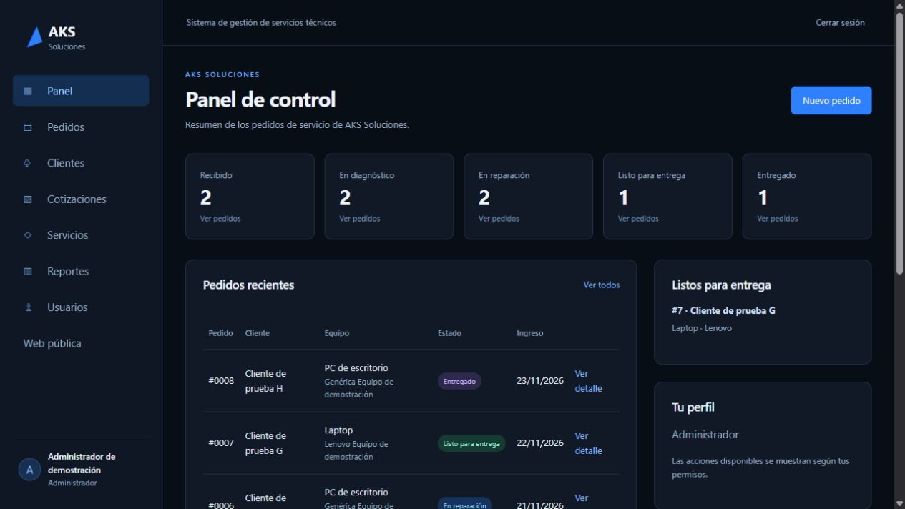

# AKS Soluciones — sistema de servicios técnicos

Proyecto académico con **Laravel 12, PHP 8.2+, Blade, Bootstrap y MySQL 8.4**. Implementa los RF1–RF6 y los ocho casos de uso del informe. El antiguo prototipo HTML se conserva en [docs/prototipo-html](docs/prototipo-html); el sistema actual se ejecuta con PHP y MySQL.



## Enlaces de las tres capas

- **Vista:** [resources/views](resources/views), estilos y scripts en [public/assets](public/assets).
- **Negocio:** [app/Services](app/Services), [controladores](app/Http/Controllers) y [permisos](app/Http/Middleware).
- **Datos:** [modelos](app/Models), [migraciones](database/migrations), [catálogos](database/seeders) y [SQL importable](database/sql/aks_soluciones.sql).
- [Arquitectura y trazabilidad](docs/ARQUITECTURA.md) · [Manual de uso](docs/MANUAL_USUARIO.md) · [Validación de la entrega](docs/VERIFICACION.md).

## Funciones

| Módulo | Qué permite |
|---|---|
| Acceso | Iniciar/cerrar sesión; validar cuenta activa y perfil; limitar intentos fallidos. |
| Pedidos | Registrar cliente/equipo nuevo o existente, falla, código de seguimiento único e historial inicial. Buscar y filtrar. |
| Atención técnica | Avanzar por los cinco estados, conservar historial y registrar entrega. |
| Clientes | Consultar, registrar y editar información de contacto. |
| Catálogo | Crear/editar servicios, actualizar precios y activar/desactivar. |
| Cotizaciones | Agregar servicios/cantidades, calcular precios en servidor, conservar detalle y exportar PDF. |
| Reportes | Pedidos, estados, cobros y tiempo de atención; filtros por fecha y PDF. |
| Usuarios | Crear cuentas, cambiar perfil/contraseña y activar/desactivar. |
| Web pública | Inicio, catálogo actualizado, dirección y seguimiento real por código sin iniciar sesión. |

Los permisos se verifican en el servidor. Recepción registra pedidos/clientes; el técnico consulta pedidos y actualiza estados; el administrador supervisa el sistema y gestiona catálogo, cotizaciones, reportes, ingresos y usuarios.

## Requisitos

- PHP **8.2 o superior**, con PDO MySQL, mbstring, OpenSSL, DOM/XML, fileinfo, curl y zip.
- Composer 2.
- **MySQL 8.4** (probado con MySQL Community Server 8.4.13). XAMPP suele incluir MariaDB: este repositorio está configurado y probado con MySQL, no depende de asumir que son el mismo producto.
- Git. Node.js es opcional; no hay que ejecutar npm ni Vite para usar estas pantallas. Bootstrap y Chart.js se incluyen localmente.

## Instalación desde GitHub

Clona el repositorio y abre su carpeta en VS Code:

```powershell
git clone https://github.com/FaithASN/AKS-Soluciones---Efsrt2---Zegel.git
cd AKS-Soluciones---Efsrt2---Zegel
composer install
Copy-Item .env.example .env
php artisan key:generate
```

Si PHP no está en PATH y ya tienes XAMPP, puedes usar `C:/xampp/php/php.exe` en lugar de `php`. Para Composer habilita zip en el php.ini de tu instalación. No desactives la comprobación TLS si aparece un error de certificados: configura el certificado de confianza correspondiente.

### Crear MySQL y configurar .env

En MySQL Workbench o su consola, conectado como administrador de tu instalación local, ejecuta (reemplaza la contraseña de ejemplo):

```sql
CREATE DATABASE aks_soluciones CHARACTER SET utf8mb4 COLLATE utf8mb4_unicode_ci;
CREATE USER 'aks'@'127.0.0.1' IDENTIFIED BY 'CAMBIA_ESTA_CLAVE';
GRANT ALL PRIVILEGES ON aks_soluciones.* TO 'aks'@'127.0.0.1';
```

Edita **tu archivo .env local**, que está excluido de Git:

```dotenv
DB_CONNECTION=mysql
DB_HOST=127.0.0.1
DB_PORT=3306
DB_DATABASE=aks_soluciones
DB_USERNAME=aks
DB_PASSWORD=tu_clave_local
```

Con MySQL encendido, crea las tablas y catálogos:

```powershell
php artisan migrate --seed
php artisan aks:crear-admin
php artisan serve --host=127.0.0.1 --port=8001
```

El comando de administrador solicita nombre, correo y una contraseña oculta. Abre **http://127.0.0.1:8001** e ingresa por Acceso del personal. Detén el servidor con Ctrl+C. También puedes usar `./scripts/iniciar.ps1` después de instalar/configurar todo. Si el puerto está ocupado, cambia `--port` o usa `./scripts/iniciar.ps1 -Puerto 8080`.

**Este sistema ya no se abre con doble clic en index.html ni con Live Server.** Las vistas Blade necesitan Laravel. El servidor debe publicar únicamente la carpeta `public/`, nunca la raíz del repositorio.

### Alternativa: MySQL con Docker

Si tienes Docker, configura DB_PASSWORD y MYSQL_ROOT_PASSWORD (distintas) en .env y ejecuta `docker compose up -d`. No lo hagas si otro MySQL ya ocupa el puerto 3306; utiliza tu instalación existente o ajusta el puerto del compose y DB_PORT. Después ejecuta las migraciones y crea el administrador como arriba. El volumen de Docker conserva los datos al reiniciar.

### Alternativa: importar el SQL

El archivo [database/sql/aks_soluciones.sql](database/sql/aks_soluciones.sql) contiene la estructura y los catálogos iniciales, **sin clientes, usuarios ni contraseñas**. Está pensado para una base nueva. Contiene también el registro técnico de la migración; no combines su importación con una creación manual de las mismas tablas. Después de importarlo, configura .env, genera APP_KEY y ejecuta `php artisan aks:crear-admin`. La ruta recomendada sigue siendo `php artisan migrate --seed`.

## Datos de demostración opcionales

En .env define `DEMO_PASSWORD` con una contraseña local de al menos 10 caracteres y ejecuta:

```powershell
php artisan db:seed --class=DemoSeeder
```

Se crean `admin@aks.test`, `tecnico@aks.test` y `recepcion@aks.test` con esa contraseña, y pedidos ficticios si la base no tiene pedidos. No sobrescribe contraseñas de cuentas existentes. Solo funciona en local/testing. No uses estas cuentas para producción. Los códigos de seguimiento son aleatorios y se consultan en el detalle de cada pedido.

## Pruebas con MySQL

Las pruebas usan una **base separada**. Crea `aks_soluciones_test` y da permisos al usuario local sobre ella. No uses una base con información real; RefreshDatabase recrea tablas en la base de prueba. La suite de AKS bloquea nombres que no terminan en `_test`.

```sql
CREATE DATABASE aks_soluciones_test CHARACTER SET utf8mb4 COLLATE utf8mb4_unicode_ci;
GRANT ALL PRIVILEGES ON aks_soluciones_test.* TO 'aks'@'127.0.0.1';
```

```powershell
php artisan test --compact
```

La entrega fue probada localmente con **17 pruebas y 118 comprobaciones** sobre MySQL real. El flujo de GitHub Actions vuelve a ejecutar las pruebas con MySQL en cada push/PR. La ejecución remota debe revisarse en la pestaña Actions; no se considera aprobada hasta que termine allí.

## Base de datos y alcance

Diez tablas: perfiles, usuarios, clientes, equipos, estados_servicio, pedidos_servicio, historial_estados, servicios, cotizaciones y detalles_cotizacion; más la tabla técnica migrations. Hay 14 relaciones FK, incluida la FK compuesta que impide asociar un equipo a un cliente diferente de su propietario.

Se usa almacenamiento UTC y presentación en Lima. No incluye facturación electrónica, pagos en línea, asignación automática de técnicos ni notificaciones por correo. El registro de importe/fecha de cobro alimenta los reportes. Precios iniciales, transición consecutiva y permisos de supervisión deben validarse con AKS. La disponibilidad 24/7 requiere alojamiento; la ejecución local no la acredita.

Laravel se distribuye con licencia MIT. Bootstrap 5.3.3 y Chart.js 4.4.9 mantienen sus avisos de licencia. Las credenciales reales, APP_KEY, sesiones, dependencias vendor y bases locales quedan fuera de Git.
